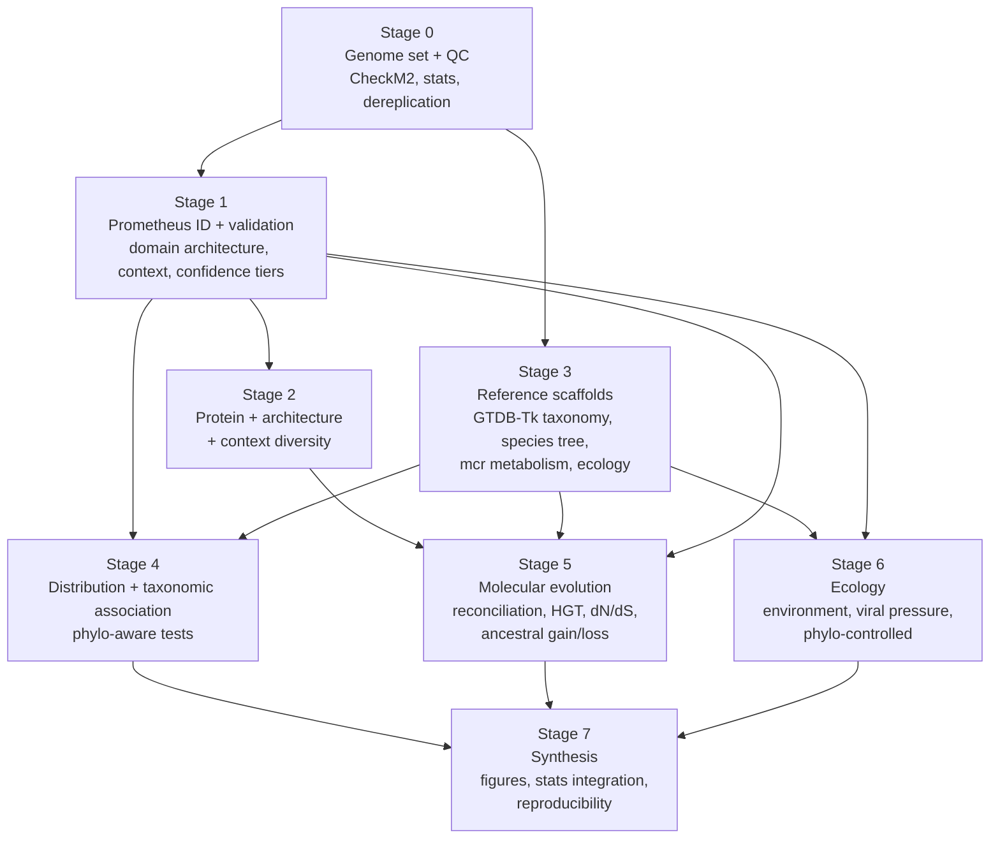

# Prometheus in Archaea: a pipeline design for diversity, distribution, evolution, taxonomy, and ecology

**Status:** design plan (v1), to be converted to Snakemake once finalized
**Target system:** Grid Engine ("Sun"/SGE-style `qsub`) cluster
**Author:** _draft for review_
**Date:** 2026-05-30

---

## 1. The biological problem, stated precisely

DefenseFinder calls a Prometheus defense system in many archaeal genomes, and the calls appear enriched in methanogens. Prometheus was characterized in *Pseudomonas* as a single large ORF (~2,221 aa) of the bacterial DNA2-like (Bad) enzyme family, with four predicted domains: DUF4011, DUF3320, a DNA2 helicase/nuclease module, and a REase MTES restriction-endonuclease domain. It restricts phages that form R-loops during transcription and has no effect on phages without predicted R-loops (van den Berg et al., *Cell Host & Microbe*, 2024). The mechanism and the deep homology to eukaryotic R-loop-processing enzymes are established; the function in archaea is not. In archaea, Prometheus has only been detected, never tested.

This pipeline turns "it's present, and it looks methanogen-associated" into defensible statements about **how diverse** archaeal Prometheus is, **where** it sits across the archaeal tree and across environments, **how it got there** (vertical inheritance vs transfer, gains and losses, selection), and **whether the methanogen association survives** the controls that usually dissolve such patterns.

Five questions, each with a failure mode the design has to close:

1. **Diversity.** How many forms of Prometheus exist in archaea, at the sequence, domain-architecture, and genomic-context levels? *Failure mode: lumping true Prometheus with housekeeping DNA2-family paralogs.*
2. **Distribution.** Across GTDB taxonomy and across a genome-derived archaeal species tree, where is it present and absent? *Failure mode: calling absence in incomplete genomes; uneven taxon sampling.*
3. **Taxonomic association.** Is the methanogen enrichment real after phylogeny, genome quality, and overall defense load are accounted for? *Failure mode: pseudoreplication from shared ancestry; methanogens are polyphyletic.*
4. **Evolution.** Vertical descent or horizontal transfer? How many independent acquisitions, and under what selection? *Failure mode: assuming vertical inheritance; ignoring per-domain histories.*
5. **Ecology.** Does presence track environment, host association, or viral pressure, beyond what taxonomy explains? *Failure mode: confounding environment with clade; biased metadata.*

---

## 2. Design principles

The whole pipeline is built around four commitments that make the eventual claims defensible.

**Presence and absence are modeled, not assumed.** Every absence is conditioned on whether the genome could have shown a presence. Genome completeness, contig fragmentation, and detection sensitivity enter the analysis as covariates, not as silent assumptions.

**Identity before counting.** A Prometheus call is not accepted because DefenseFinder emitted it. It's accepted after the four-domain architecture, catalytic residues, and genomic context are checked, and after the protein is placed phylogenetically away from cellular DNA2/NurA-HerA paralogs. Counting starts only on a curated, confidence-tiered catalog.

**Phylogeny is the unit of analysis, not the genome.** Genomes are not independent observations. Methanogens do not form a clade; methanogenesis arose (most likely once) and was lost repeatedly, so "methanogen" is a metabolic state scattered across the tree. Every association test is run in a phylogenetic comparative framework, with the naive contingency-table version reported only as a labeled baseline.

**Metabolism is defined from genes, not from names.** "Methanogen" is assigned from the methyl-coenzyme M reductase complex (`mcrABG`) and the supporting pathway found in the genome, not from the order name in the taxonomy. This keeps the trait definition independent of the taxonomy used to test associations, and it captures methyl-reducing methanogens in lineages outside the classical orders.

---

## 3. Pipeline at a glance (DAG)



Every box becomes one Snakemake module with explicit input and output files. The stage numbering is logical, not strictly temporal: Stage 3 (reference scaffolds) runs in parallel with Stages 1–2 because it depends only on the genomes, and Stages 4–6 are the analyses that consume both branches.

---

## 4. Stage 0 — Genome set, quality, and provenance

> **Implementation note (current pipeline).** Stage 0 is realized as a batched Phase-1 preprocessing front-end over the raw input genomes (e.g. ~92k): GTDB-Tk classification in ~20k-genome batches, CheckM2 completeness/contamination, and BBMap assembly statistics, merged onto the input metadata. A quality score (completeness − 5×contamination) is computed, genomes are filtered (completeness ≥ 90, contamination ≤ 5, < 1000 contigs, contig-N50 > 5 kb, score > 50), and the set is collapsed to one representative per GTDB species (highest score). This replaces dRep (§0.4) and the MIMAG tiering below. The `group_*`/`niche_*` presence-absence columns are unioned across each species' genomes so quality filtering and collapsing do not erase where a species was observed; that union is the ecological signal used in Stage 6. The sub-sections below describe the rationale; the niche aggregation set ("all" input genomes vs only quality-passing) is configurable.

**Goal.** Turn a pile of assemblies into a defined, quality-controlled, dereplicated genome set with one metadata row per genome. This table is the backbone every later stage joins against.

**Inputs.**
- Archaeal assemblies (FASTA nucleotide), one per species-level genome.
- Existing DefenseFinder outputs (per genome).
- Existing ecological metadata (user-supplied; ingested in Stage 3).

**Steps.**

*0.1 Inventory and provenance.* Build a genome registry keyed by a stable genome ID. Record source (NCBI/GTDB/IMG/in-house), accession, assembly level (complete, chromosome, scaffold, contig), isolate vs MAG/SAG, and the assembly date. Provenance matters later: MAGs and isolates have different error modes, and the presence/absence model treats them differently.

*0.2 Genome quality.* Run **CheckM2** (single best estimate of completeness and contamination, ML-based, handles reduced-genome archaea better than CheckM1 lineage markers). Record completeness, contamination, and the model used. Compute assembly statistics independently (genome size, N50, contig count, longest contig, coding density, GC) with `seqkit`/`assembly-stats`. Call rRNA and tRNA presence (`barrnap`, `tRNAscan-SE`) to support MIMAG quality tiers for MAGs.

*0.3 Quality tiering.* Assign each genome a tier: high (e.g., completeness ≥ 90%, contamination ≤ 5%, near-complete for isolates), medium, low. Tiers are not used to discard data wholesale; they're carried as covariates and used for stratified sensitivity analyses. Genomes below a hard floor (e.g., completeness < 50% or contamination > 10%) are flagged and excluded from primary presence/absence analysis but retained for sequence diversity if they carry a validated Prometheus.

*0.4 Dereplication decision (a decision point; see §13).* If the set is already GTDB species representatives, skip. Otherwise dereplicate with **dRep** (or use GTDB species clusters) at 95% ANI to one genome per species, so prevalence is not inflated by sequencing the same species many times. Keep the mapping from representatives to members; over-sampled species are a real bias in defense-system surveys.

*0.5 Gene prediction baseline.* Standardize gene calls with **Prodigal** (archaeal mode) or **Bakta**, even if DefenseFinder used its own, so that genomic-context and synteny work downstream uses one consistent coordinate space. Store proteins (`.faa`), genes (`.ffn`), and a GFF per genome.

**Outputs.**
- `genome_metadata.tsv` (one row per genome: IDs, source, assembly level, CheckM2 completeness/contamination, assembly stats, rRNA/tRNA, quality tier, dereplication cluster).
- Standardized per-genome `.faa`, `.ffn`, `.gff`.

**Defensibility notes.** Completeness and contamination are the two numbers that most often explain away a defense-system pattern. Capturing them at Stage 0, per genome, is what lets Stage 4 model absence honestly. Reviewers of defense-system surveys ask first about MAG quality and species-level redundancy; both are handled here before any counting.

---

## 5. Stage 1 — Prometheus identification, validation, and curation

> **Implementation note (current pipeline).** Detection is restricted to DefenseFinder's Prometheus calls. The PADLOC cross-check and the custom HMM sweep described in 1.5–1.6 below are not run. The downstream validation (domain architecture, phylogenetic separation from cellular paralogs, defense-island context, confidence tiers) is unchanged; tier A correspondingly rests on the full canonical four-domain architecture plus Prometheus placement and intact catalytic modules, rather than on agreement across detectors.

This is the crux. DNA2 is, in its cellular role, an essential replication and repair enzyme; archaea run much of that chemistry through NurA (nuclease) and HerA (helicase) rather than a DNA2 fusion, but DNA2-family homologs and other helicase-nuclease proteins exist and can trip a homology search. A Prometheus catalog built on raw DefenseFinder hits will contain both false positives (housekeeping paralogs, partial hits) and false negatives (real systems missed by strict architecture rules or split across contig boundaries). Stage 1 produces a curated, confidence-tiered catalog instead.

**Goal.** A vetted set of archaeal Prometheus loci, each with sequence, coordinates, domain architecture, genomic context, and a confidence tier, plus an explicit account of detection sensitivity.

**Steps.**

*1.1 Parse DefenseFinder.* Extract every Prometheus call: system instance, the contributing gene hit(s), HMM profile name(s), bitscore, i-evalue, coverage, and genomic coordinates. Record the exact DefenseFinder and model-database versions (the model set changes between releases; a claim is only reproducible against a pinned version). Pull the protein sequence for each hit from the standardized `.faa`.

*1.2 Confirm domain architecture.* Run **hmmscan** against Pfam-A and **InterProScan** on each candidate protein and test for the diagnostic signature: DUF4011, DUF3320, the DNA2 helicase/nuclease module (RecB-family nuclease + SF1B helicase), and the REase MTES domain. Classify each candidate by which domains are present and in what order. A full four-domain protein is the canonical form; partial architectures are kept but flagged (they may be degenerate, pseudogenized, fragmented by assembly, or genuinely divergent).

*1.3 Catalytic-residue check.* Align candidates to the characterized *Pseudomonas* Prometheus and inspect conservation of the nuclease active-site residues, the helicase Walker A/B motifs, and the REase catalytic residues. A protein with the architecture but disrupted catalytic residues is a candidate pseudo-system and is tiered accordingly; this distinction matters for the selection analysis in Stage 5.

*1.4 Separate from cellular paralogs.* Build a reference set of (i) characterized Prometheus/Bad-family proteins, (ii) archaeal NurA/HerA, (iii) eukaryotic and bacterial housekeeping DNA2, and (iv) other archaeal helicase-nuclease enzymes. Place all archaeal candidates on a single guide tree with these references (see Stage 5 for the method). Candidates that fall within the cellular-paralog clades, rather than with Prometheus, are reclassified as non-Prometheus regardless of the DefenseFinder call. This step is what stops the entire analysis from being a survey of replication enzymes.

*1.5 Genomic context / defense-island test.* For each candidate, extract the flanking genes (e.g., ±10 ORFs) and test for the hallmarks of a defense locus: proximity to other defense systems, to mobile genetic elements, to integrases/recombinases, and to known defense-island markers. Re-run **PADLOC** independently on these regions and on whole genomes. Defense-context association raises confidence; an isolated DNA2-like gene sitting in a conserved housekeeping neighborhood lowers it.

*1.6 Independent sensitivity sweep.* DefenseFinder's architecture rules are tuned for specificity, so they miss divergent or fragmented systems. Run an orthogonal, more sensitive search: a profile HMM (or a small set, one per domain) built from validated archaeal Prometheus proteins, searched across all genomes with **hmmsearch** at a permissive threshold, then re-validated through 1.2–1.5. This recovers likely true systems DefenseFinder didn't call and, just as importantly, quantifies the false-negative rate so Stage 4 can correct for detection sensitivity. Cross-tabulate DefenseFinder vs PADLOC vs HMM sweep.

*1.7 Assembly-edge and fragmentation handling.* Flag candidates whose ORF runs off a contig end or spans a scaffold gap; a ~2.2 kb-protein gene is long enough to be split in fragmented assemblies. These become "present-fragmented" rather than "absent," and they're tracked separately so a fragmented hit is never scored as a confident absence.

*1.8 Confidence tiers.* Combine the evidence into tiers:
- **A (high):** full four-domain architecture, conserved catalytic residues, defense-context, places with Prometheus phylogenetically, called by ≥2 methods.
- **B (medium):** most architecture present or one line of evidence weaker (e.g., single-method call with good architecture, or defense-context but partial architecture).
- **C (low / candidate):** divergent, partial, or context-ambiguous; retained, labeled, and used only in sensitivity analyses.
- **Rejected:** falls in cellular-paralog clade or lacks defense signal; moved out of the Prometheus set with the reason recorded.

**Outputs.**
- `prometheus_catalog.tsv` (locus ID, genome ID, coordinates, contributing HMMs and scores, domain architecture string, catalytic-residue status, context summary, detecting tools, confidence tier, rejection reason if any).
- `prometheus_proteins.faa` and per-locus context FASTA/GFF.
- `detection_sensitivity.tsv` (per-genome: called by DefenseFinder / PADLOC / HMM sweep; used as a covariate later).

**Defensibility notes.** The two questions a skeptic asks ("how do you know these aren't just DNA2 housekeeping genes?" and "how do you know the absences are real?") are answered by 1.2–1.5 and by 1.6–1.7 respectively. Confidence tiers let every downstream result be reported at tier A alone and at A+B, so conclusions that depend on shaky calls are visible as such.

---

## 6. Stage 2 — Diversity of archaeal Prometheus

**Goal.** Describe how many forms of Prometheus exist in archaea and on what axes they vary: sequence, domain architecture, catalytic potential, and genomic context.

**Steps.**

*2.1 Sequence clustering and subfamilies.* Cluster the validated proteins with **MMseqs2** at a graded series of identity thresholds (e.g., 30/50/70/90%) and with sensitive all-vs-all search. The 30% level approximates subfamilies; the higher levels resolve recent diversification. Summarize cluster counts, sizes, and singletons, and record which clusters are methanogen-only, non-methanogen-only, or mixed (a first, descriptive look at the association, formalized later).

*2.2 Domain-architecture typology.* From the Stage 1 architecture strings, enumerate the distinct architectures: canonical four-domain, domain losses, domain insertions, fusions or fissions, and any reordering. Tabulate architecture against subfamily and against taxonomy. Domain shuffling is biologically meaningful here because the four domains may have independent evolutionary histories (tested in Stage 5).

*2.3 Catalytic-potential classes.* Group loci by the catalytic-residue status from Stage 1.3: intact nuclease+helicase+REase, partial, or degenerate. This separates likely-active systems from candidate pseudogenes and frames the selection analysis.

*2.4 Genomic-context diversity.* Cluster the flanking-gene neighborhoods (from Stage 1.5) by shared content and synteny using **clinker** and a **cblaster/c-style** gene-cluster comparison. Recurrent neighborhoods (e.g., Prometheus consistently beside a particular system, integrase, or anti-defense gene) are catalogued as context types. This is where the data hint at how Prometheus is mobilized and what it co-localizes with.

*2.5 Length and composition.* Report ORF length distribution, GC of the locus vs the host genome (a first HGT signal), and codon usage deviation, all per subfamily.

**Outputs.**
- `prometheus_subfamilies.tsv`, cluster membership at each threshold.
- `architecture_typology.tsv`, distinct architectures with counts.
- `context_types.tsv`, recurrent genomic neighborhoods.
- Diversity summary figures (rarefaction of subfamilies vs genomes sampled; architecture × taxonomy matrix).

**Defensibility notes.** Reporting subfamily richness as a rarefaction against genomes sampled, rather than as a raw count, keeps the diversity claim honest given uneven taxon sampling. Tracking methanogen-only vs mixed clusters here sets up, but does not substitute for, the formal association test.

---

## 7. Stage 3 — Reference scaffolds: taxonomy, species tree, metabolism, ecology

This stage builds the three coordinate systems every association rests on: a standardized taxonomy, a genome-derived species tree, and a gene-based metabolic classification. It also ingests and standardizes the user-supplied ecological metadata. It depends only on the genome set, so it runs in parallel with Stages 1–2.

**Goal.** A unified per-genome table joining taxonomy, species-tree position, metabolic type (with methanogen status defined from genes), and harmonized ecology.

**Steps.**

*3.1 Standardized taxonomy.* Run **GTDB-Tk** `classify_wf` (pinned GTDB release) for every genome, giving a consistent rank assignment from domain to species and the placement in the GTDB reference. Record the closest reference, ANI, and the assigned taxonomy. GTDB is the right backbone because its ranks are normalized by relative evolutionary divergence, which makes "prevalence by family" comparable across the tree.

*3.2 Archaeal species tree.* Build the tree the distribution and comparative analyses are mapped onto. Two complementary products:
- **Reference-anchored:** place the focal genomes into the GTDB archaeal reference tree (de novo workflow, GTDB-Tk `de_novo_wf` with the archaeal marker set, or pruning the GTDB tree to the focal taxa). Fast, standardized, good for the distribution maps.
- **De novo focal tree:** for the genomes that matter to the comparative tests, infer a maximum-likelihood tree from a concatenated, quality-filtered marker alignment (GTDB ar53 markers or a curated archaeal single-copy set), with **IQ-TREE2**, per-partition or mixture models, model selection by BIC, and support from ultrafast bootstrap + SH-aLRT. Assess saturation and long-branch artifacts; archaea include fast-evolving lineages (e.g., Nanoarchaeota, some DPANN) that distort placement. Run a posterior-mean-site-frequency (PMSF) or CAT-style analysis for the deep nodes if the focal set spans the domain. Provide a time-free tree for comparative methods and, optionally, a relative-time chronogram (penalized likelihood / `treePL`) if any rate-aware analysis needs branch lengths in time.
- **Rooting (defensible).** Root the species tree before any comparative or ancestral use, because stochastic gain/loss mapping (and the independent-acquisition count), phyloglm, fitPagel, the D statistic, and GeneRax's UndatedDTL all assume a correct root. Prefer outgroup rooting on a designated lineage outside the focal set; use midpoint only as a labelled fallback, since rate variation across fast-evolving lineages (DPANN/Nanoarchaeota) makes midpoint unreliable. The root of Archaea itself is contested for domain-wide trees, so any deep-root-dependent conclusion (e.g., the direction of the earliest gains) should be checked for robustness to the root choice.

*3.3 Metabolic classification, defining "methanogen" from genes.* Annotate each genome for energy metabolism with **METABOLIC**, **DRAM**, or curated KO/Pfam HMM sets, and specifically detect the methanogenesis machinery: `mcrABG` (and `mcrCD`), the Wood–Ljungdahl/methyl-branch markers, methyltransferases (`mtaA/mtbA/mttB` families), and the relevant hydrogenases. Assign:
- methanogen vs non-methanogen (presence of a credible Mcr complex), and
- methanogenesis subtype where present: hydrogenotrophic, acetoclastic, methylotrophic, methyl-reducing/H2-dependent.
- Flag **anaerobic methanotrophs (ANME)**, which carry divergent `mcr` but run it in reverse; they must not be silently counted as methanogens.
Defining the trait from `mcr` rather than from the order name keeps the predictor independent of the GTDB taxonomy used in the association test, and it captures methyl-reducing methanogens in lineages outside the classical orders (e.g., within Thermoproteota). Record both the gene-based call and the taxonomy-based expectation, and reconcile disagreements manually.

*3.4 Ecology harmonization.* Ingest the user's ecological metadata and standardize it. Map free-text isolation sources and environments onto the **ENVO** controlled vocabulary (biome, environmental material) and, where available, capture physicochemistry (temperature class / optimum, salinity, pH, oxygen relationship) and host association (e.g., gut/rumen, free-living, symbiont). Where the user's metadata is sparse, optionally augment from NCBI BioSample and JGI GOLD by accession, but keep provenance of every field and never overwrite curated values. Quantify and report missingness per field; ecology fields are the most bias-prone input in the whole pipeline.

*3.5 Build the master table.* Left-join everything onto the Stage 0 registry: quality, taxonomy, tree tip ID, metabolic type and methanogen call, ecology, and (from Stage 1) Prometheus presence/tier and detection-sensitivity covariates. This single table drives Stages 4–6.

**Outputs.**
- `taxonomy_gtdbtk.tsv`; archaeal species tree(s) (`.treefile`, reference-anchored and de novo) with support values.
- `metabolism.tsv` (per-genome pathway calls, methanogen status, subtype, ANME flag).
- `ecology_harmonized.tsv` (ENVO-mapped fields, physicochemistry, host, provenance, missingness flags).
- `master_table.tsv` (the analysis backbone).

**Defensibility notes.** Three independent failure modes are closed here: defining methanogens from `mcr` removes the circularity of testing a taxonomy-defined trait against taxonomy; a genome-derived ML tree (not a taxonomy proxy) gives the comparative methods a real covariance structure; and explicit ENVO mapping with recorded missingness stops the ecology analysis from quietly running on a biased subset.

---

## 8. Stage 4 — Distribution and taxonomic association

**Goal.** Quantify where Prometheus is present across taxonomy and the species tree, and test the methanogen association in a way that survives phylogeny, genome quality, and overall defense load.

**Steps.**

*4.1 Prevalence, modeled not tabulated.* Compute Prometheus prevalence by taxonomic rank (phylum → genus), each with a binomial confidence interval, and report it at tier A and tier A+B. Crucially, present prevalence alongside per-taxon median completeness and sample size, so a low prevalence in a poorly sampled, low-completeness clade is not read as biological absence.

*4.2 Map onto the tree.* Render presence/absence, confidence tier, and methanogen status on the archaeal species tree (the distribution figure). This is descriptive but it's where independent acquisitions become visible as scattered tips vs clustered clades, the qualitative read that Stage 5 quantifies.

*4.3 Naive association (baseline, labeled as such).* Fisher's exact / χ² for methanogen × Prometheus, and a logistic regression of presence on methanogen status. Report it, then state plainly that it assumes independence the data don't have. It exists so readers can see how much the phylogenetic correction changes the estimate.

*4.4 Phylogenetically-controlled association (the real test).* Test methanogen ↔ Prometheus with methods that account for shared ancestry:
- **Phylogenetic logistic regression** (`phylolm`/`phyloglm`, Ives & Garland) with Prometheus presence as the binary response and methanogen status as the predictor, on the de novo species tree.
- **Correlated-evolution test** with **BayesTraits** (Pagel's Dependent vs Independent model, Bayes factors) or a binary-trait threshold model, to ask whether the two traits' gains and losses are coupled across the tree rather than merely co-present at the tips.
- **Phylogenetic signal** of Prometheus presence itself (the **D statistic**, Fritz & Purvis) to report whether presence is phylogenetically clustered, overdispersed, or random, which dictates how much the correction should matter.

*4.5 Condition on confounders.* Extend the phylogenetic regression with covariates: genome completeness (and the detection-sensitivity flag from Stage 1.6), genome size, and, importantly, the **total count of defense systems** per genome. Methanogens may simply carry more defense systems overall; the methanogen term has to survive conditioning on total defense load before "methanogen-associated Prometheus" means anything specific. Optionally model defense-system count itself (negative-binomial, phylogenetically-controlled) to characterize the background.

*4.6 Co-occurrence with other defense systems.* Test pairwise co-occurrence and mutual exclusivity between Prometheus and the other DefenseFinder systems, with a phylogeny-aware null (not the naive `cooccur`), correcting for genome size and FDR across the system pairs. Mutual exclusivity with a functionally overlapping system, or recurrent co-occurrence within an island, is a lead worth reporting.

**Outputs.**
- `prevalence_by_taxon.tsv` with CIs, sampling, and completeness.
- `association_tests.tsv` (naive and phylogenetic estimates, effect sizes, CIs, model comparisons).
- `cooccurrence.tsv`.
- Annotated tree figure (presence/tier/methanogen/ecology rings).

**Defensibility notes.** The headline number is the methanogen effect from the phylogenetic model after conditioning on completeness and total defense load, with the naive estimate shown beside it for contrast. If the association is an artifact of clade structure or of methanogens being defense-rich generally, this is where it collapses, and that result would itself be the finding.

---

## 9. Stage 5 — Molecular evolution and phylogenomics of Prometheus

**Goal.** Reconstruct how Prometheus came to be where it is: vertical inheritance vs transfer, the number and placement of independent acquisitions, the histories of the four domains, and the selection acting on them.

**Steps.**

*5.1 Family alignment and gene tree.* Align validated Prometheus proteins with **MAFFT** (L-INS-i) or **FAMSA** for the larger set; trim with **ClipKIT** (kpic-gappy) or **BMGE**. Infer the gene tree with **IQ-TREE2**, best-fit model by ModelFinder, UFBoot2 + SH-aLRT, and a separate run under a profile mixture model (C-series/PMSF) for the deep splits. Root with the housekeeping DNA2/NurA-HerA references from Stage 1.4 as outgroup, or by midpoint/MAD if the outgroup is too divergent.

*5.2 Per-domain trees and shuffling.* Because the four domains may not share one history, build separate alignments and trees for the DNA2 helicase/nuclease, the REase MTES, and each DUF, then compare topologies (tanglegrams, normalized Robinson–Foulds, and AU tests of forced congruence). Domain trees that disagree localize where shuffling, fusion, or independent acquisition happened, and they tell you which domain to trust for the species-history question.

*5.3 Gene-tree/species-tree reconciliation.* Reconcile the Prometheus gene tree against the Stage 3 archaeal species tree to infer duplications, transfers, and losses:
- **GeneRax** (species-tree-aware ML reconciliation under a DTL model) for a point estimate of events and rates.
- **ALE** (amalgamated likelihood, using the UFBoot tree distribution) for transfer inference that accounts for gene-tree uncertainty, and for transfer directionality between donor and recipient lineages.
Quantify the vertical vs transferred fraction and identify donor→recipient pairs. Transfers into methanogen lineages, and whether they come from other archaea, bacteria, or viruses, are the specific outputs that bear on the methanogen question.

*5.4 Orthogonal HGT signals.* Cross-check the reconciliation with composition-based signals that don't depend on the tree: GC and tetranucleotide deviation of the locus vs host genome, codon-usage distance, and physical proximity to integrases/MGEs/proviruses (from Stage 1.5 and Stage 6.4). Agreement between phylogenetic and compositional signals strengthens a transfer call; recent transfers show compositional signal, old ones don't, so disagreement is informative rather than contradictory.

*5.5 Ancestral gain/loss across the archaeal tree.* With presence/absence at the tips and the species tree, reconstruct the history of Prometheus acquisition and loss using **Count** (Csurös, birth–death gain/loss) and/or stochastic character mapping (`phytools::make.simmap`) under ML-fitted rates, with **BadiRate** as a rate-model cross-check. Report the inferred number of independent gains, their phylogenetic placement, and subsequent losses. Test directly whether gains coincide with methanogen lineages more than expected under the fitted loss/gain model. This is the evolutionary form of the association question, and the one least confounded by tip-level clade structure.

*5.6 Selection analysis.* Build in-frame codon alignments (protein-guided, **PAL2NAL**) per subfamily/domain and estimate selection with **HyPhy**: site-wise **FEL** and **MEME** (episodic diversifying selection), gene-wide **BUSTED**, branch-site **aBSREL**, and **RELAX** to test whether selection intensity differs between methanogen and non-methanogen branches. Diversifying selection concentrated on the nuclease/REase surfaces would be the molecular signature of a host–virus conflict; **RELAX** answers whether that pressure is stronger in methanogen lineages specifically. Restrict dN/dS to catalytically-intact loci (Stage 2.3) so pseudogene relaxation doesn't masquerade as a signal.

**Outputs.**
- Prometheus gene tree and per-domain trees (with support).
- `reconciliation/` (GeneRax + ALE event counts, transfer table with donors/recipients, vertical/HGT fraction).
- `ancestral_states/` (gain/loss map, number and placement of independent acquisitions).
- `selection/` (per-site and per-branch dN/dS, RELAX methanogen-vs-not result).

**Defensibility notes.** Vertical inheritance is never assumed; it's an outcome of the reconciliation. The independent-acquisition count comes from two methods (Count + stochastic mapping) and is cross-checked against the tip-level co-occurrence in Stage 4, so the evolutionary and distributional analyses have to agree before a "methanogen-associated" story is told. Gene-tree uncertainty enters through ALE's use of the bootstrap distribution rather than a single tree.

---

## 10. Stage 6 — Ecology

**Goal.** Determine whether Prometheus presence tracks environment, host association, or viral pressure beyond what taxonomy and phylogeny already explain.

**Steps.**

*6.1 Environmental enrichment, phylogenetically controlled.* Test Prometheus presence against ENVO biome/material, oxygen relationship, temperature and salinity class, and host association, using the same phylogenetic logistic framework as Stage 4 (so a habitat signal isn't just a clade signal in disguise). Report effect sizes with FDR correction across environment terms.

*6.2 Methanogen niche resolution.* Within methanogens, ask whether Prometheus-carrying genomes occupy particular niches (rumen and gut, anaerobic digesters, freshwater and marine sediments, hydrothermal systems), and whether the methanogenesis subtype (Stage 3.3) predicts presence. Methanogenesis type and habitat are correlated, so fit them jointly and report partial effects.

*6.3 Viral pressure proxy.* The mechanism is anti-viral, so presence should be examined against viral exposure. Predict proviruses and viral contigs in each genome with **geNomad** and assess prophage load and completeness (**CheckV**). Test whether Prometheus presence correlates with proviral load, again phylogenetically controlled. This is a proxy (host-virus interaction can't be read off genomes alone), and it's framed as one.

*6.4 R-loop-targeting hypothesis (mechanistic tie-back).* Prometheus acts on R-loop-forming viral transcripts. Where proviruses are recovered, predict R-loop-prone regions (high G-skew / transcribed GC-rich stretches; e.g., a `QmRLFS`-style or skew-based predictor) and test whether genomes carrying Prometheus are enriched for proviruses with predicted R-loop potential relative to genomes without. A positive result would connect the archaeal distribution to the characterized mechanism; a null is still publishable and bounds the hypothesis.

**Outputs.**
- `ecology_associations.tsv` (environment/host/subtype effects, phylo-controlled, FDR).
- `viral_context.tsv` (provirus load, CheckV quality, predicted R-loop potential, association with Prometheus).

**Defensibility notes.** Every ecological claim is run through the phylogenetic model, because biome and clade are deeply confounded in archaea (halophiles, thermophiles, and methanogens each concentrate in particular environments and particular parts of the tree). The viral and R-loop analyses are labeled as genome-based proxies for processes that ultimately need experimental test.

---

## 11. Stage 7 — Synthesis, figures, and reproducibility

**Goal.** Integrate the five questions into one coherent, reproducible account, with publication-ready figures and a single multiple-testing regime.

**Steps.**

*7.1 Integrated figure set.* A master tree figure (archaeal species tree with presence/tier, methanogen status, subtype, ecology, and proviral-load rings) built in **iTOL** or **ggtree**; prevalence-by-taxon bars with CIs; a forest plot of association effect sizes (naive vs phylogenetic, with and without confounder conditioning); a gene-tree/species-tree tanglegram annotated with inferred transfers; and a selection map per domain.

*7.2 Statistical integration.* Collect every hypothesis test into one registry and apply a single false-discovery-rate correction within families of tests (associations, co-occurrence, ecology, selection). Report effect sizes and intervals, not just p-values. Pre-register the primary hypotheses (methanogen association after confounders; HGT fraction; independent-acquisition count) so the confirmatory and exploratory results are distinguishable.

*7.3 Sensitivity analyses.* Re-run the headline results under: tier A only vs A+B; with and without low-completeness genomes; reference-anchored vs de novo tree; and dereplicated vs full set. A conclusion that flips across these is reported as fragile.

*7.4 Reproducibility package.* Pin every tool version and database release; ship conda/mamba environments (or containers) per rule; record the Snakemake DAG, config, and random seeds; and version the intermediate tables. The Prometheus catalog, master table, trees, and the figure-generating scripts are released together so a reader can rebuild any panel.

**Outputs.**
- Figure set + figure scripts.
- `results_registry.tsv` (every test, statistic, effect size, FDR-adjusted p).
- Reproducibility bundle (envs, config, DAG, seeds, versioned tables).

**Defensibility notes.** Separating confirmatory from exploratory tests and applying one FDR regime is what keeps a five-question study from turning into an uncontrolled multiple-comparisons exercise. The sensitivity battery is the honest report of which conclusions are load-bearing.

---

## 12. Cross-cutting confounders and where each is handled

This table is the defensibility backbone. Every row is a way the study could be wrong, and the column that closes it.

| # | Confounder / failure mode | Why it matters | Handled in |
|---|---|---|---|
| 1 | False absence in incomplete genomes | A ~2.2 kb gene is easy to miss in a fragmented MAG; absence ≠ not encoded | Stage 0 (CheckM2, tiers), 1.7 (fragmentation flags), 4.1/4.5 (completeness as covariate) |
| 2 | False presence from contamination | Contaminant contigs in MAGs create phantom systems | Stage 0 (contamination filter), 1.5 (taxonomic consistency of the contig) |
| 3 | Detection sensitivity/specificity | DefenseFinder rules favor specificity; divergent systems missed | Stage 1.6 (orthogonal HMM sweep, PADLOC, sensitivity covariate) |
| 4 | Housekeeping DNA2 / NurA-HerA confusion | DNA2 is a cellular replication/repair enzyme; not every hit is a defense system | Stage 1.2–1.5 (architecture, catalytic residues, context, phylogenetic separation) |
| 5 | Phylogenetic non-independence | Genomes share ancestry; methanogens are polyphyletic, not a clade | Stage 4.4 (phyloglm, BayesTraits, D), 5.5 (gain/loss model), 6 (phylo-controlled) |
| 6 | Circular trait definition | Testing a taxonomy-defined "methanogen" against taxonomy is circular | Stage 3.3 (methanogen defined from `mcr`, independent of GTDB) |
| 7 | Sampling / database bias | Cultured methanogens over-represented; uneven taxon sampling | Stage 0.4 (species dereplication), 2.1 (rarefaction), 4.1 (sampling reported) |
| 8 | "More defense systems overall" | Methanogens may just be defense-rich; Prometheus rides along | Stage 4.5 (condition on total defense count) |
| 9 | HGT vs vertical inheritance | Assuming vertical descent misreads the history | Stage 5.3–5.4 (reconciliation + compositional signals) |
| 10 | Per-domain history ignored | The four domains may have different origins | Stage 5.2 (per-domain trees, shuffling) |
| 11 | Environment ↔ clade confounding | Biome and taxonomy are deeply correlated in archaea | Stage 6.1 (phylo-controlled environment tests) |
| 12 | Multiple testing | Five questions, many tests, inflated false positives | Stage 7.2 (one FDR regime; confirmatory vs exploratory) |
| 13 | Pseudogenes inflating selection signal | Relaxed selection on dead genes mimics a signal | Stage 2.3 + 5.6 (restrict dN/dS to intact loci) |
| 14 | Causality overreach | Genomic association is not function | Stage 6 + §17 (proxies labeled; experiments proposed) |

---

## 13. Decision points that need your input before coding

A handful of choices change the Snakemake graph and should be settled first.

1. **Genome set definition.** Are your assemblies already GTDB species representatives, or should the pipeline dereplicate (Stage 0.4)? This sets whether dRep is a rule or a no-op, and it determines the denominator for every prevalence number.
2. **Tree scope for comparative tests.** Domain-wide archaeal tree, or focal subtrees around the clades that carry Prometheus? Domain-wide is more general but brings long-branch/DPANN placement problems; focal is cleaner but narrows the inference. This drives the IQ-TREE2 configuration in Stage 3.2.
3. **Tier policy for primary results.** Tier A only, or A+B, as the headline set (with the other as sensitivity)? Affects power vs stringency throughout.
4. **Ecology augmentation.** Use only your curated metadata, or also auto-pull BioSample/GOLD for gaps (Stage 3.4)? The latter adds coverage and adds noise; your call on the trade-off.
5. **DefenseFinder version pinning.** Confirm the exact DefenseFinder release and model database your existing outputs came from, so Stage 1.1 parses the right schema and the Prometheus model/gene names match. If outputs span versions, we re-run to one pinned version.
6. **Reference protein set for Stage 1.4.** I'll seed it with the characterized *Pseudomonas* Prometheus, archaeal NurA/HerA, and DNA2 references; tell me if you have in-house references or a preferred curated set.

---

## 14. Execution on a Grid Engine ("Sun"/SGE) cluster

Snakemake drives the workflow; Grid Engine runs the jobs. The design assumes `qsub`-style submission and parallel environments, not SLURM.

**Submission.** Use Snakemake's cluster execution against Grid Engine, either through the generic cluster interface or DRMAA:

```bash
# Generic cluster submission (Snakemake ≥8: snakemake-executor-plugin-cluster-generic)
snakemake \
  --jobs 200 \
  --executor cluster-generic \
  --cluster-generic-submit-cmd \
    'qsub -cwd -V -N {rule} -pe smp {threads} \
          -l h_vmem={resources.mem_mb}M,h_rt={resources.runtime} \
          -o logs/{rule}/{wildcards}.o -e logs/{rule}/{wildcards}.e' \
  --default-resources mem_mb=4000 runtime=240 \
  --use-conda --conda-frontend mamba \
  --rerun-incomplete --keep-going
```

DRMAA (`--drmaa`) is an alternative if the cluster exposes `libdrmaa`. A cluster profile (`profiles/sge/config.yaml`) keeps the submit string out of the command line and lets each rule declare its own `threads`, `mem_mb`, and `runtime`.

**Parallelism.** Most of the work is embarrassingly parallel over genomes: scatter CheckM2, GTDB-Tk, gene prediction, DefenseFinder/PADLOC, and HMM sweeps as per-genome (or batched) jobs, then gather. Multithreaded rules request a parallel environment slot count via `-pe smp {threads}`; confirm the exact PE name on your cluster (`qconf -spl` lists them, often `smp`, `make`, or `mpi`) and set it in the profile.

**Resource-heavy rules to plan for.**
- **GTDB-Tk** `classify_wf` — large reference data and a pplacer step that wants tens of GB RAM; give it a high-`h_vmem` queue and stage the GTDB release on fast/local scratch.
- **IQ-TREE2** species tree with mixture models — many cores, long wall time; checkpoint and use `-T AUTO` bounded by the PE slots.
- **GeneRax / ALE** — MPI-capable; size by gene-family count.
- **InterProScan** — staged lookup data; batch proteins to amortize startup.

**Data staging and reproducibility.** Pin GTDB, Pfam/InterPro, CheckM2, and DefenseFinder/PADLOC database releases; stage them once on shared or node-local scratch. Keep `--use-conda` so each rule resolves its own environment; the same Snakefile then runs on the cluster or locally by swapping the profile.

---

## 15. Tooling summary (pin exact versions at build time)

| Stage | Step | Tools |
|---|---|---|
| 0 | QC, stats, dereplication, genes | CheckM2; seqkit / assembly-stats; barrnap; tRNAscan-SE; dRep; Prodigal / Bakta |
| 1 | Detection + validation | DefenseFinder (MacSyFinder); PADLOC; HMMER (hmmscan/hmmsearch); InterProScan; Pfam-A; MAFFT |
| 2 | Diversity | MMseqs2; clinker; cblaster; custom domain/typology scripts |
| 3 | Scaffolds | GTDB-Tk; IQ-TREE2 (ModelFinder, UFBoot2, PMSF); METABOLIC / DRAM; ENVO; treePL (optional) |
| 4 | Distribution + association | R: phylolm/phyloglm, caper (D statistic), BayesTraits; statsmodels; FDR |
| 5 | Evolution | IQ-TREE2; ClipKIT / BMGE; GeneRax; ALE; Count; BadiRate; phytools; PAL2NAL; HyPhy (FEL/MEME/BUSTED/aBSREL/RELAX) |
| 6 | Ecology | geNomad; CheckV; R-loop predictor (skew/QmRLFS-style); phyloglm |
| 7 | Synthesis | iTOL / ggtree; R/Python plotting; Snakemake report |

---

## 16. Suggested phasing

The full plan is large; it splits naturally into three runs so results land early and the heavy evolutionary work builds on a vetted catalog.

- **Phase 1 — foundation (Stages 0, 1, 3).** Genome QC, the curated and confidence-tiered Prometheus catalog, taxonomy, species tree, metabolism, ecology harmonization. Deliverable: the master table and the detection-sensitivity audit. Nothing downstream is trustworthy until this is solid.
- **Phase 2 — distribution and diversity (Stages 2, 4).** Subfamilies and architectures; prevalence; the phylogenetically-controlled methanogen association with confounders. Deliverable: the headline association result with its sensitivity panel.
- **Phase 3 — evolution and ecology (Stages 5, 6, 7).** Reconciliation, HGT, ancestral gains/losses, selection; ecological and viral-pressure tests; integrated figures and the reproducibility bundle.

---

## 17. What this pipeline can and can't settle

Genomics can establish the diversity, the distribution, the transfer history, the selection regime, and whether the methanogen and ecological associations hold up under phylogeny and the usual confounders. That's a defensible, publishable account, and it generates specific, testable mechanistic hypotheses.

It can't, on its own, show that archaeal Prometheus is an active anti-viral system, or that it targets R-loops in archaeal viruses the way the *Pseudomonas* protein does in phages. Those are experimental questions, and the system is tractable for them: heterologous expression and viral challenge, R-loop mapping (DRIP-seq or S9.6-based assays) on infected cells, and catalytic-dead mutants of the nuclease/helicase/REase domains. The pipeline is designed to point at the right candidates for that work (the catalytically-intact, high-confidence loci under diversifying selection in well-sampled methanogen lineages) rather than to substitute for it. Framing the genomic results as hypothesis-generating, with the experiments named, is part of what makes the analysis defensible rather than overreaching.

---

## 18. Key references

- van den Berg D.F., Costa A.R., Esser J.Q., Stanciu I., Geissler J.Q., Zoumaro-Djayoon A.D., Haas P.-J., Brouns S.J.J. Bacterial homologs of innate eukaryotic antiviral defenses with anti-phage activity highlight shared evolutionary roots of viral defenses. *Cell Host & Microbe* 32(8):1427–1443.e8 (2024). [doi:10.1016/j.chom.2024.07.007](https://doi.org/10.1016/j.chom.2024.07.007). — Prometheus characterization (Bad/DNA2 family, four-domain architecture, R-loop mechanism). Indexed in PubMed (PMID 39094584).
- Tesson F., et al. Systematic and quantitative view of the antiviral arsenal of prokaryotes (DefenseFinder). *Nat. Commun.* 13:2561 (2022). — Detection framework, models, decision rules.
- Néron B., et al. A comprehensive resource for exploring antiphage defense: DefenseFinder webservice, wiki and databases. *bioRxiv* 2024.01.25.577194. — Current models/wiki.
- Payne L.J., et al. PADLOC: a web server for the identification of antiviral defence systems. *Nucleic Acids Res.* (2022). — Orthogonal detection.
- Chklovski A., et al. CheckM2: a rapid, scalable and accurate tool for assessing microbial genome quality. *Nat. Methods* (2023). — Completeness/contamination.
- Chaumeil P.-A., et al. GTDB-Tk v2: genome classification. *Bioinformatics* (2022); Parks D.H., et al. GTDB. — Standardized taxonomy and reference tree.
- Minh B.Q., et al. IQ-TREE 2. *Mol. Biol. Evol.* (2020). — ML phylogenetics, mixture models, UFBoot2.
- Morel B., et al. GeneRax: species-tree-aware ML gene-tree inference and reconciliation. *Mol. Biol. Evol.* (2020); Szöllősi G.J., et al. ALE (amalgamated likelihood estimation). — DTL reconciliation, transfer inference.
- Csurös M. Count: ancestral gene-family reconstruction by likelihood. *Bioinformatics* (2010); Revell L.J. phytools. — Ancestral gain/loss.
- Kosakovsky Pond S.L., et al. HyPhy / datamonkey (FEL, MEME, BUSTED, aBSREL, RELAX). — Selection analysis.
- Ho L.S.T. & Ané C. phylolm; Pagel M. & Meade A. BayesTraits; Fritz S.A. & Purvis A. D statistic. — Phylogenetic comparative methods.
- Borrel G., Adam P.S., Gribaldo S., et al. on methanogen polyphyly and the evolution of methanogenesis (Euryarchaeota split into Halobacteriota/Methanobacteriota/Thermoplasmatota; methyl-reducing methanogens in Thermoproteota). — Trait-definition rationale for Stage 3.3.
- Camargo A.P., et al. geNomad (2024); Nayfach S., et al. CheckV (2021). — Provirus identification and quality.
